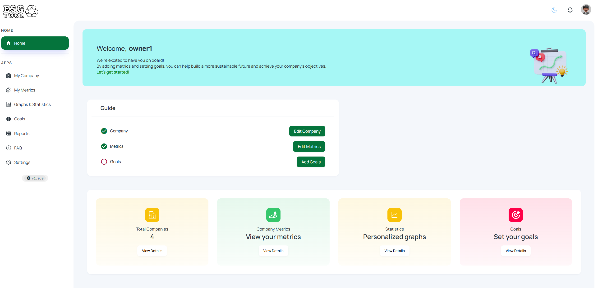
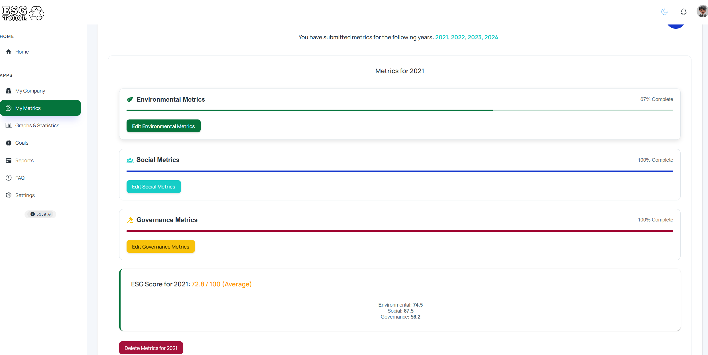
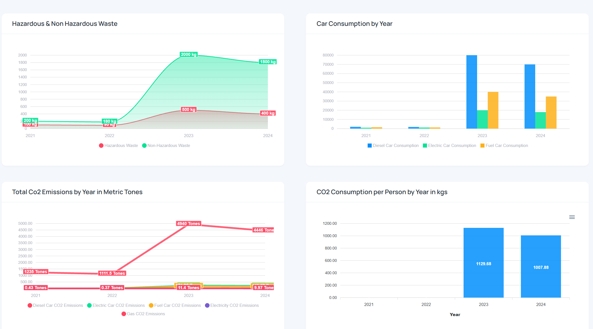
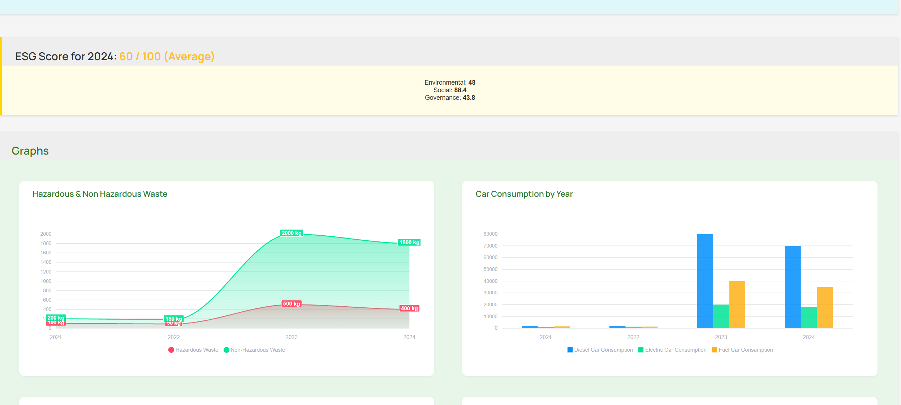
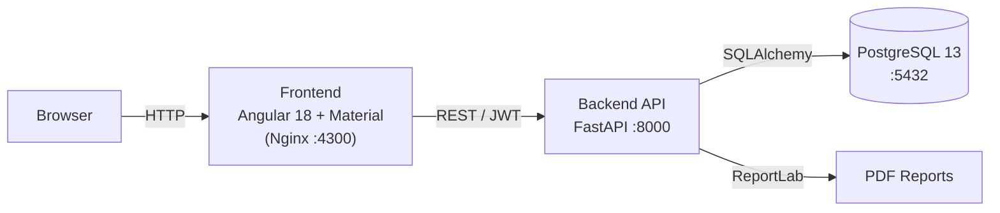

# ESG Reporting Platform

A full-stack platform for collecting, tracking and reporting **Environmental, Social and Governance (ESG)** metrics across a portfolio of companies. It provides per-company dashboards, multi-year metric tracking, target setting, an automatically computed ESG score and downloadable PDF reports — with role-based access for regular users and administrators.


---

## Overview



The ESG Reporting Platform lets an organisation register companies and record their sustainability data year by year, then turns that data into insights: statistics and charts, progress against goals, a per-year ESG score, and exportable reporting documents.

- **Multi-company portfolio** — an admin manages all companies; a user sees their own.
- **Three ESG pillars** — dedicated metric models for Environmental, Social and Governance data.
- **Historical tracking** — every metric is tied to a year, enabling year-over-year comparison.
- **Analytics** — charts for waste, fleet fuel, gender distribution, compensation ratio and turnover.
- **ESG score** — a 0–100 score per pillar plus an overall rating.
- **Reporting** — server-side generated PDF reports plus supporting-document uploads.
- **Security** — JWT authentication, hashed passwords and role-based route guards.

<!-- Screenshots: drop images into docs/screenshots/ and reference them here, e.g.
| Dashboard | Metrics | Reports |
| --- | --- | --- |
|  |  |  |
-->


---

## Features

### 🌱 Environmental
- Track electricity, gas, diesel and fuel consumption, fleet electricity use and hazardous / non-hazardous waste.
- Record building name, surface area, turnover and reporting year.
- Upload supporting consumption documents (PDF) per metric.

### 👥 Social
- Headcount breakdowns by gender, employment type (permanent/temporary, full/part-time) and age group.
- New hires and leavers, voluntary / involuntary turnover rates.
- Pay-gap data: average hourly earnings by gender, CEO-to-median-employee compensation ratio.

### 🏛️ Governance
- Structured assessments for anti-corruption, whistleblowing, corporate culture and business conduct.
- Per-section completion tracking used to derive the governance score.



### 🎯 Goals & targets
- Define targets with a target year, including CO₂ reduction percentage and gender-balance targets.
- Goals are linked to the environmental, social and governance metrics.

### 📊 Dashboards & statistics



- Interactive charts (ApexCharts) for waste, fleet fuel, hazardous waste by year, gender ratio, compensation ratio and turnover rate.
- Per-company metrics view and an industry distribution chart.

### ⭐ ESG scoring
- Automatic 0–100 score for each pillar and an overall ESG score with a `Good` / `Average` / `Needs Improvement` label.

### 📄 Reporting & documents



- Download a generated PDF ESG report for a company/year (ReportLab).
- Upload, download and delete company and environmental evidence PDFs.

### 🔐 Accounts & access
- JWT auth with registration, login, change-password and admin password reset.
- Roles (`admin` / `owner` / `user`) with Angular route guards and admin-only management screens.
- Admin tools: companies table, user manager.

### 🧰 UX
- Material Design UI, collapsible sidebar, year selector, FAQ and account settings.
- i18n-ready via `ngx-translate`.

---

## Tech Stack

| Layer | Technology |
| --- | --- |
| **Frontend** | Angular 18, Angular Material & CDK, TypeScript 5.4, RxJS, ng-apexcharts (ApexCharts), angular-tabler-icons, ngx-translate, ngx-scrollbar, jwt-decode, file-saver |
| **Backend** | FastAPI 0.114, Uvicorn, SQLAlchemy 2.0 ORM, Pydantic 2, python-jose / PyJWT, passlib, ReportLab, python-multipart |
| **Database** | PostgreSQL 13 |
| **Auth** | OAuth2 password flow + JWT bearer tokens, bcrypt password hashing |
| **Infrastructure** | Docker & Docker Compose, Nginx (serves the built frontend) |

### Architecture



---

## Project Structure

```
esg_platform/
├── backend/                 # FastAPI application
│   ├── app/
│   │   ├── main.py          # App entrypoint, CORS, routers
│   │   ├── auth.py          # JWT auth, register/login, roles
│   │   ├── models.py        # SQLAlchemy models (Company, User, metrics, Goal)
│   │   ├── schemas.py       # Pydantic schemas
│   │   ├── crud.py          # DB operations
│   │   ├── database.py      # Engine & session
│   │   ├── utils.py         # PDF generation helpers
│   │   └── routers/         # ESG API endpoints
│   ├── create_tables.py     # Create the database schema
│   ├── populate_dummy_data.py
│   ├── requirements.txt
│   └── Dockerfile
├── frontend/                # Angular application
│   ├── src/app/
│   │   ├── pages/           # Auth, metrics, company, reports, admin screens
│   │   ├── components/      # Dashboards, charts, dialogs, guides
│   │   ├── services/        # API clients & business logic
│   │   ├── guards/          # auth / admin route guards
│   │   └── models/          # TypeScript interfaces
│   ├── nginx.conf
│   └── Dockerfile
├── docker-compose.yml       # db + backend + frontend
├── .env.example
└── README.md
```

---

## Getting Started

### Prerequisites

- [Docker](https://www.docker.com/) & Docker Compose (recommended), **or**
- [Node.js](https://nodejs.org/) 18+, [Python](https://www.python.org/) 3.11+ and a [PostgreSQL](https://www.postgresql.org/) instance for local development.

### 1. Configure environment

Copy the example file and adjust the values:

```bash
cp .env.example .env
```

| Variable | Description |
| --- | --- |
| `POSTGRES_USER` | PostgreSQL username |
| `POSTGRES_PASSWORD` | PostgreSQL password |
| `POSTGRES_DB` | Database name |
| `SECRET_KEY` | Secret used to sign JWT tokens |
| `SQLALCHEMY_DATABASE_URL` | Full SQLAlchemy connection string |
| `ALLOWED_ORIGINS` | Comma-separated list of allowed CORS origins |

### 2. Run with Docker Compose

```bash
docker compose up --build
```

- Frontend → http://localhost:4300
- Backend API → http://localhost:8000
- Interactive API docs (Swagger UI) → http://localhost:8000/docs

### 3. Run locally (without Docker)

**Backend**

```bash
cd backend
pip install -r requirements.txt
python create_tables.py          # create the schema
python populate_dummy_data.py    # optional: seed sample data
python -m uvicorn app.main:app --reload
```

**Frontend**

```bash
cd frontend
npm install
npm start                        # ng serve → http://localhost:4200
```

---

## API Reference

The API is documented automatically by FastAPI. Once the backend is running, explore the full schema at **`/docs`** (Swagger UI) or **`/redoc`**.

Main route groups:

| Prefix | Purpose |
| --- | --- |
| `/auth` | Token, registration, password change/reset |
| `/companies` | Company CRUD, metrics aggregate, ESG score, reports, document uploads |
| `/environmental_metrics` | Environmental metrics CRUD & evidence files |
| `/social_metrics` | Social metrics CRUD |
| `/governance_metrics` | Governance metrics CRUD |
| `/goals` | Target management |

---

## License

This project is provided for educational and demonstration purposes. Add a `LICENSE` file to specify the terms under which it may be used.
